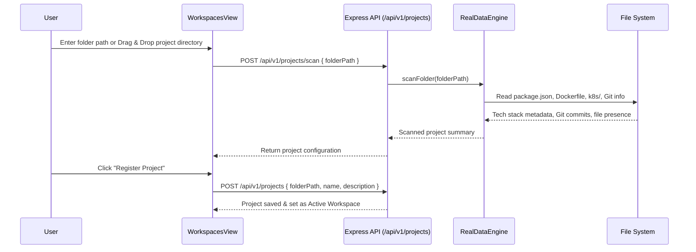

# DevOpsHub: Technical Architecture & System Documentation

---

## 1. Executive Summary

**DevOpsHub** is a full-stack, enterprise-grade **Cloud-Native & DevSecOps Platform Control Plane**. It serves as a unified operational interface that bridges **real host-system infrastructure** (local Docker daemon, Kubernetes clusters, Git version control, system telemetry, and security scanners) with **automated CI/CD pipelines, GitOps workflows, Terraform Infrastructure-as-Code (IaC), distributed tracing, and automated SRE self-healing engines**.

The platform is designed to provide complete observability, proactive governance, security gating, and deployment orchestration in a single interface.

---

## 2. Technology Stack & Platform Architecture

### High-Level Architecture Diagram

```mermaid
graph TB
    subgraph "Frontend Layer (Port 5173)"
        UI[React 19 + TypeScript + Vite SPA]
        Ctx[DevSecOpsContext Central State Engine]
        UI <--> Ctx
        
        subgraph "Interactive Views & Panels"
            V1[Dashboard Overview]
            V2[Workspaces / Multi-Project]
            V3[CI/CD Orchestration]
            V4[Security & Quality Gate]
            V5[Docker & Container Control]
            V6[Kubernetes Cluster View]
            V7[GitOps & Diffs]
            V8[Helm Marketplace]
            V9[Terraform IaC Planner]
            V10[OpenTelemetry Tracing]
            V11[API Load Tester]
            V12[SRE Self-Healing Engine]
            V13[Interactive Web Terminal]
            V14[AI DevOps & SRE Copilot]
        end
        UI --> V1 & V2 & V3 & V4 & V5 & V6 & V7 & V8 & V9 & V10 & V11 & V12 & V13 & V14
    end

    subgraph "Backend API Layer (Port 5001)"
        API[Express.js Micro-Server]
        DB[(Persistent DB: data_store.json)]
        
        API <--> DB
        
        subgraph "Core Server Engines"
            E1[RealDataEngine]
            E2[LocalDevOpsIntegrator]
            E3[ExtendedDevOpsEngine]
            E4[SecurityScanner]
            E5[TelemetryEngine]
        end
        
        API --> E1 & E2 & E3 & E4 & E5
    end

    subgraph "Host Machine & Cloud Infrastructure"
        OS[Host Operating System / Process Shell]
        Docker[Docker Engine / /var/run/docker.sock]
        K8s[Kubernetes Cluster / ~/.kube/config]
        Git[Git Version Control & NPM Engine]
        Prom[Prometheus Scraper & Grafana]
    end

    Ctx <--> |REST API / Polling (2.5s)| API
    E1 <--> OS & Git
    E2 <--> Docker & K8s & Prom
    E3 <--> Docker & K8s & OS
    E4 <--> Git
    E5 <--> OS
```

### Core Technologies

| Layer | Technology | Key Libraries / Frameworks | Purpose |
| :--- | :--- | :--- | :--- |
| **Frontend** | React 19, TypeScript, Vite | Tailwind CSS, Lucide React, Recharts, Canvas Confetti | Responsive UI, real-time charts, high-performance rendering |
| **State Layer** | React Context & Hooks | `DevSecOpsContext`, Custom Polling Hooks | Centralized telemetry, cluster state, and active workspace sync |
| **Backend API** | Node.js (ES Modules), Express | `cors`, `child_process`, `util.promisify`, Node `http`/`https` | REST endpoints, CLI bridge, telemetry aggregation |
| **Data Persistence**| JSON-backed Store | `server/data_store.json`, `PersistentDB` | Retaining project registries, deployment ledgers, pod states |
| **Infrastructure** | Host Subsystems | Docker CLI, `kubectl`, Git CLI, NPM CLI, OS Telemetry | Executing real container actions, cluster discovery, and audits |

---

## 3. Subsystem Breakdown & Module Logic

### 3.1. Central State & Telemetry Synchronization
- **Frontend**: `src/context/DevSecOpsContext.tsx`
- **Backend**: `server/telemetry.js`, `server/db.js`

1. **Initial Bootstrapping**: On application load, `DevSecOpsContext` fetches registered workspaces, deployment history, real Docker container states, and cluster workloads.
2. **Rolling Telemetry Loop**: Every 2.5 seconds, the client polls `/api/v1/telemetry` and `/api/v1/real/system`. The telemetry engine calculates live requests per second (RPS), P95 event loop latency, and host system metrics (CPU utilization %, Memory utilization %, Heap size).
3. **Prometheus Compatibility**: The backend exposes native Prometheus metrics at `/api/metrics` following standard OpenMetrics specifications (`# HELP` and `# TYPE` annotations).

---

### 3.2. Workspaces & Multi-Project Engine
- **Frontend**: `src/components/workspaces/WorkspacesView.tsx`
- **Backend**: `server/realData.js` (`RealDataEngine.scanFolder`)



**Key Capabilities:**
- Real-time file system inspection.
- Auto-detection of frameworks (React, Next.js, Express, Vite, TypeScript, Tailwind).
- Dynamic binding: Selecting an active project updates the entire platform (Git diffs, security audits, terminal working directory, environment variables).

---

### 3.3. CI/CD Orchestration & Pipeline Simulation
- **Frontend**: `src/components/cicd/CICDView.tsx`
- **Backend**: `server/realData.js` (`RealDataEngine.runRealPipeline`)

The CI/CD module supports two operational modes:
1. **Real Host Build Execution**:
   - Executes `npm run build` directly inside the active project directory.
   - Captures stdout/stderr, validates TypeScript compilation, measures build duration, and writes an entry into the **Deployments Ledger**.
2. **Interactive Scenarios & Edge Cases**:
   - **Happy Path**: Simulates a complete 18-stage pipeline from commit to Argo CD deployment.
   - **CVE Security Gate Failure**: Demonstrates automatic pipeline abortion when critical vulnerabilities are found.
   - **Zero-Downtime Rolling Update**: Visualizes pod-by-pod rolling rollout with readiness probes.
   - **Canary Release & Auto-Rollback**: Demonstrates a 10% traffic split, anomaly detection, and automated rollback upon elevated error rates.

---

### 3.4. DevSecOps Security, SAST & SCA Scanners
- **Frontend**: `src/components/security/SecurityView.tsx`
- **SAST Scanner**: `server/scanners.js`
- **SCA Scanner & Fix**: `server/realData.js`

**Inspection Mechanisms:**
- **Static Application Security Testing (SAST)**: Recursively parses project source files (`.ts`, `.tsx`, `.js`) to detect:
  - Hardcoded credentials and API tokens.
  - Insecure `eval()` usage.
  - Permissive wildcard CORS configurations (`Access-Control-Allow-Origin: *`).
- **Software Composition Analysis (SCA)**: Invokes `npm audit --json` to discover vulnerable dependencies, CVSS scores, and fixed versions.
- **1-Click Auto-Remediation**: Triggers `npm audit fix` from the UI, re-evaluating the quality gate dynamically.

---

### 3.5. Docker Engine & Container Controller
- **Frontend**: `src/components/docker/DockerManagerView.tsx`
- **Backend**: `server/localIntegrations.js`, `server/extendedIntegrations.js`

**Capabilities:**
- Probes `/var/run/docker.sock` to detect local containers and images.
- Performs container lifecycle actions (`start`, `stop`, `restart`, `rm`, image build).
- **Quick-Launch Tool Stack**: One-click container orchestration for local developer stacks:
  - PostgreSQL 16 (`postgres:16-alpine` on port 5432)
  - Redis 7 (`redis:7-alpine` on port 6379)
  - Prometheus (`prom/prometheus:v2.52.0` on port 9090)
  - Grafana (`grafana/grafana:10.4.2` on port 3000)
  - Nginx (`nginx:alpine` on port 8088)

---

### 3.6. Kubernetes Cluster & Workload Controller
- **Frontend**: `src/components/kubernetes/KubernetesClusterView.tsx`
- **Backend**: `server/localIntegrations.js`, `server/extendedIntegrations.js`

**Capabilities:**
- Discovers live cluster topology (Nodes, Pods, Deployments, Services, Cluster Events) via `kubectl` and `~/.kube/config`.
- Real-time **Deployment Scaling**: Dynamically scale replica counts via `kubectl scale deployment <name> --replicas=<N>`.
- **Pod Lifecycle Management**: Trigger pod evictions/restarts.
- **Manifest Apply**: Apply raw YAML manifests directly to the cluster with instant rollback tracking.

---

### 3.7. GitOps, Helm, Terraform & Tracing

| Subsystem | View Component | Backend Engine | Operational Logic |
| :--- | :--- | :--- | :--- |
| **GitOps** | `GitOpsDiffView.tsx` | `extendedIntegrations.js` | Computes `git diff` against HEAD, identifies staged/unstaged files, executes commits and remote pushes. |
| **Helm** | `HelmManagerView.tsx` | `extendedIntegrations.js` | Manages Helm chart releases (Ingress Nginx, Cert-Manager, Redis) with installation and uninstallation pipelines. |
| **Terraform IaC** | `TerraformIaCView.tsx` | `extendedIntegrations.js` | Parses HCL infrastructure code, runs `terraform plan`, and estimates monthly AWS cloud costs. |
| **Tracing** | `DistributedTracingView.tsx` | `extendedIntegrations.js` | Visualizes end-to-end OpenTelemetry trace waterfalls across Ingress, Node.js microservices, and PostgreSQL queries. |
| **Traffic Benchmarker** | `ApiTesterAndBenchmarkerView.tsx` | `extendedIntegrations.js` | Executes concurrent HTTP load tests and generates latency histograms (P50, P90, P95, P99). |

---

### 3.8. SRE Self-Healing Engine & Webhook Alerts
- **Frontend**: `src/components/selfhealing/SelfHealingEngineView.tsx`
- **Backend**: `server/extendedIntegrations.js`

**Watchdog Mechanism:**
1. **Rule Engine**: Evaluates active alert conditions (CrashLoopBackOff, OOMKilled 137, High Memory Headroom, Traffic Surges).
2. **Automated Remediation Actions**:
   - Automated Pod restarts with memory headroom recovery.
   - HPA replica scaling from 2 to 6 replicas during sustained high traffic.
   - Immediate rollback of canary deployments on breach of error budgets (>5%).
3. **Webhook Dispatcher**: Dispatches structured JSON alerts to configured webhooks (Slack, Discord, PagerDuty).

---

### 3.9. Developer Utilities & Productivity Suite

1. **Interactive Web Terminal** (`InteractiveTerminalDrawer.tsx`):
   - Toggle with `Ctrl + ` ` (backtick).
   - Executes arbitrary shell commands securely inside the active project directory.
2. **Global Command Palette** (`CommandPaletteModal.tsx`):
   - Toggle with `Cmd + K` or `Ctrl + K`.
   - Quick navigation to any module, triggering builds, launching databases, or opening configuration modals.
3. **AI DevOps & SRE Copilot** (`AIChatBotDrawer.tsx`):
   - Context-aware virtual engineer with live access to telemetry, CVE databases, and Docker/K8s status.
4. **DevOps Asset Generator** (`AssetGeneratorModal.tsx`):
   - Generates production-ready multi-stage `Dockerfile`, `deployment.yaml`, `service.yaml`, and GitHub Actions workflow `.github/workflows/ci-cd.yml` tailored to the active project's tech stack.
5. **Environment & Secrets Vault** (`SecretsManagerModal.tsx`):
   - Secure `.env` editor with one-click export to Kubernetes base64-encoded `Secret` manifests.

---

## 4. Comprehensive REST API Reference

### 1. Health & Telemetry Endpoints

| Method | Endpoint | Description |
| :--- | :--- | :--- |
| `GET` | `/api/healthz` | Kubernetes standard liveness probe (returns `{ status: "UP" }`) |
| `GET` | `/api/readyz` | Kubernetes readiness probe |
| `GET` | `/api/metrics` | Prometheus metrics exporter (OpenMetrics text format) |
| `GET` | `/api/v1/telemetry` | JSON telemetry (RPS, latency, CPU %, RAM %, heap size) |
| `GET` | `/api/v1/real/system` | Real OS telemetry (`os.cpus()`, `os.totalmem()`, network interfaces) |

### 2. Workspaces & Projects

| Method | Endpoint | Request Body | Description |
| :--- | :--- | :--- | :--- |
| `GET` | `/api/v1/projects` | — | Lists all registered workspace folders and active project |
| `POST` | `/api/v1/projects` | `{ folderPath, name, description }` | Registers a new workspace folder |
| `POST` | `/api/v1/projects/select` | `{ projectId }` | Switches active workspace |
| `POST` | `/api/v1/projects/scan` | `{ folderPath }` | Scans a folder without registering it |

### 3. Deployments & Pipelines

| Method | Endpoint | Request Body | Description |
| :--- | :--- | :--- | :--- |
| `GET` | `/api/v1/deployments` | Query `?projectId=` (optional) | Retrieves deployment history records |
| `POST` | `/api/v1/deployments` | Partial `DeploymentRecord` | Records a new deployment ledger item |
| `POST` | `/api/v1/real/pipeline/run` | `{ projectPath }` (optional) | Runs real `npm run build` on the host and records deployment |

### 4. Security & Quality Gates

| Method | Endpoint | Request Body | Description |
| :--- | :--- | :--- | :--- |
| `GET` | `/api/v1/code-analysis` | — | Executes static source code SAST analysis |
| `GET` | `/api/v1/dependencies` | — | Scans dependencies from `package.json` |
| `GET` | `/api/v1/real/audit` | Query `?path=` (optional) | Runs `npm audit --json` on active project |
| `POST` | `/api/v1/security/remediate`| `{ projectPath }` (optional) | Executes `npm audit fix` on active project |
| `GET` | `/api/v1/vulnerabilities` | — | Lists recorded CVE vulnerabilities |
| `POST` | `/api/v1/vulnerabilities/patch` | `{ vulnId }` | Marks a vulnerability as patched |

### 5. Local Docker Integrations

| Method | Endpoint | Request Body | Description |
| :--- | :--- | :--- | :--- |
| `GET` | `/api/v1/local/docker` | — | Checks Docker daemon status and lists containers |
| `GET` | `/api/v1/docker/images` | — | Lists all Docker images on the host |
| `POST` | `/api/v1/docker/action` | `{ action, containerId }` | Executes `start`, `stop`, or `restart` |
| `POST` | `/api/v1/docker/build` | `{ projectPath, imageName }` | Builds Docker image from Dockerfile |
| `POST` | `/api/v1/tools/launch` | `{ toolName, action }` | Launches tool stack (postgres, redis, grafana, prometheus) |

### 6. Kubernetes Cluster Controller

| Method | Endpoint | Request Body | Description |
| :--- | :--- | :--- | :--- |
| `GET` | `/api/v1/local/kubernetes` | — | Probes `kubectl` context and node states |
| `GET` | `/api/v1/k8s/workloads` | — | Returns Pods, Deployments, Services, and Events |
| `POST` | `/api/v1/k8s/scale` | `{ name, namespace, replicas }` | Scales target deployment replica count |
| `POST` | `/api/v1/k8s/pod/restart` | `{ podName, namespace }` | Restarts a specific pod |
| `POST` | `/api/v1/k8s/apply` | `{ yamlContent, projectPath }` | Applies Kubernetes YAML manifest |

### 7. DevOps Utilities, IaC & AI

| Method | Endpoint | Request Body | Description |
| :--- | :--- | :--- | :--- |
| `POST` | `/api/v1/terminal/exec` | `{ command, projectPath }` | Executes shell command in project directory |
| `POST` | `/api/v1/devops/generate-assets` | `{ projectPath, writeToDisk }` | Generates Dockerfile, K8s manifests, and GitHub Actions |
| `GET` | `/api/v1/env` | Query `?path=` | Reads `.env` variables |
| `POST` | `/api/v1/env/save` | `{ envVars, exportK8s, projectPath }` | Saves `.env` and exports optional K8s Secret |
| `POST` | `/api/v1/ai/chat` | `{ message }` | Context-aware AI SRE Copilot endpoint |
| `POST` | `/api/v1/traffic/benchmark` | `{ url, requests, concurrency }` | Runs HTTP benchmark and computes latency percentiles |
| `GET` | `/api/v1/terraform/config` | — | Returns Terraform HCL and estimated AWS costs |
| `POST` | `/api/v1/terraform/plan` | `{ tfCode }` | Executes `terraform plan` simulation |

---

## 5. Data Models & Schemas

### Project Workspace (`ProjectWorkspace`)
```typescript
interface ProjectWorkspace {
  id: string;
  name: string;
  path: string;
  type: string;
  description: string;
  branch: string;
  commitHash: string;
  author: string;
  techStack: string[];
  dockerfilePresent: boolean;
  k8sManifestsPresent: boolean;
  jenkinsfilePresent: boolean;
  lastScanned: string;
}
```

### Deployment Record (`DeploymentRecord`)
```typescript
interface DeploymentRecord {
  id: string;
  projectId: string;
  projectName: string;
  environment: 'production' | 'staging' | 'canary';
  branch: string;
  commitHash: string;
  commitMessage: string;
  author: string;
  status: 'SUCCESS' | 'FAILED' | 'ROLLED_BACK' | 'IN_PROGRESS';
  dockerImage: string;
  dockerImageSize: string;
  k8sNamespace: string;
  k8sDeployment: string;
  k8sReplicas: string;
  jenkinsJob: string;
  jenkinsBuildNumber: number;
  duration: string;
  logs: string[];
  timestamp: string;
}
```

### Telemetry Point (`MetricPoint`)
```typescript
interface MetricPoint {
  timestamp: string;
  timeLabel: string;
  rps: number;
  latencyMs: number;
  errorRatePercent: number;
  cpuPercent: number;
  memoryPercent: number;
  activePods: number;
}
```

---

## 6. Local Setup & Execution Guide

### Prerequisites
- **Node.js**: v18.0.0 or higher
- **NPM**: v9.0.0 or higher
- **Optional Tools for Live Integrations**:
  - Docker Desktop (for container management)
  - `kubectl` configured with Minikube, Kind, or Docker Desktop K8s
  - Git CLI

### Quick Start Commands

```bash
# 1. Install dependencies
npm install

# 2. Run both the Express backend and Vite frontend concurrently
npm run dev:all

# 3. Alternative: Run services individually
npm run server  # Starts Express Backend on http://localhost:5001
npm run dev     # Starts Vite Frontend on http://localhost:5173
```

### Useful URLs
- **Frontend Dashboard**: `http://localhost:5173`
- **Backend API**: `http://localhost:5001`
- **Prometheus Scrape Endpoint**: `http://localhost:5001/api/metrics`
- **Cluster Liveness Probe**: `http://localhost:5001/api/healthz`
- **Active Projects API**: `http://localhost:5001/api/v1/projects`
