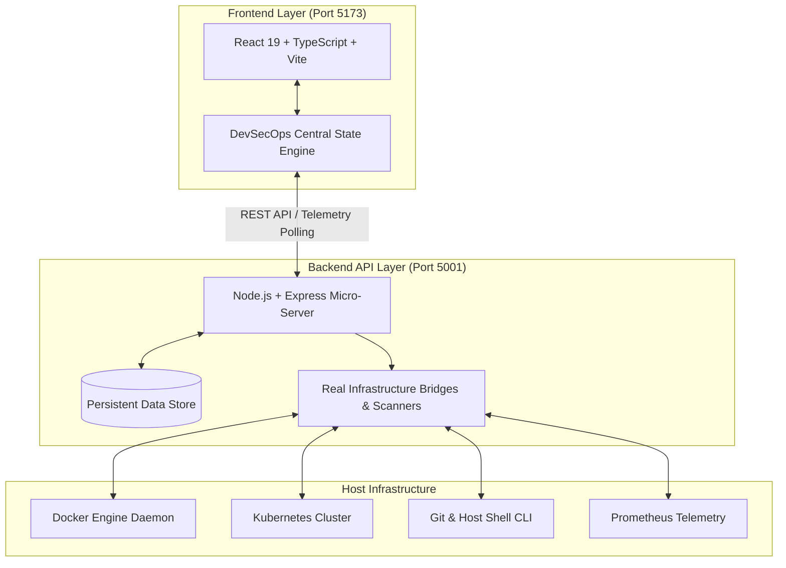

# Unified DevOps Platform (DevOpsHub) 🚀

> An enterprise-grade **Cloud-Native & DevSecOps Platform Control Plane** unifying real infrastructure discovery, Kubernetes/Docker container management, automated CI/CD pipelines, GitOps workflows, Terraform IaC, OpenTelemetry tracing, and SRE self-healing engines.

---

## 🌟 Key Features

- 🖥️ **Live Infrastructure & Cluster Control**: Real-time integration with host Docker Engine (`/var/run/docker.sock`) and Kubernetes clusters (`~/.kube/config`).
- 🛡️ **DevSecOps & Quality Gate**: Automated security scanning (SAST, secret leakage detection, dependency audits, license compliance).
- 🔄 **CI/CD Pipeline Orchestrator**: Interactive stage execution, visual build graphs, artifact inspection, and real-time streaming logs.
- 📦 **GitOps & Helm Marketplace**: Git-driven configuration sync, drift detection, and single-click Helm chart deployment.
- 🏗️ **Terraform IaC Planner**: Interactive multi-cloud infrastructure designer with real-time `terraform plan` simulation.
- 📊 **OpenTelemetry & Prometheus Observability**: Distributed tracing, latency waterfall views, RPS monitoring, and Prometheus OpenMetrics exporter.
- 🩺 **Automated SRE Self-Healing**: Live incident detection with rule-based auto-remediation (Pod restarts, memory leak mitigation, auto-scaling).
- 🤖 **AI DevOps Copilot & Terminal**: Interactive in-browser web terminal and intelligent assistant for debugging Kubernetes, logs, and build errors.

---

## 🏗️ Architecture Overview



For complete architectural deep-dives, subsystem contracts, and API specs, see [ARCHITECTURE_AND_DOCS.md](./ARCHITECTURE_AND_DOCS.md).

---

## 🚀 Quick Start

### Prerequisites
- **Node.js**: v18+ (v20+ recommended)
- **NPM** / **Yarn** / **PNPM**
- **Docker** & **kubectl** (optional, for live container & cluster integration)

### Installation

```bash
# Clone the repository
git clone https://github.com/RonakNaik08/unified-devops-platform.git
cd unified-devops-platform

# Install dependencies
npm install
```

### Running the Application

To run both the backend server and frontend concurrently:

```bash
npm run dev:all
```

- **Frontend**: [http://localhost:5173](http://localhost:5173)
- **Backend API**: [http://localhost:5001](http://localhost:5001)
- **Prometheus Metrics**: [http://localhost:5001/api/metrics](http://localhost:5001/api/metrics)

---

## 🛠️ Tech Stack

- **Frontend**: React 19, TypeScript, Vite, Tailwind CSS, Lucide Icons, Recharts
- **Backend**: Node.js, Express.js (ES Modules), Child Process CLI bridges
- **Data Persistence**: JSON-backed atomic store (`server/data_store.json`)
- **Observability**: OpenTelemetry standard format, Prometheus OpenMetrics exporter

---

## 📄 License

This project is licensed under the [MIT License](LICENSE).
